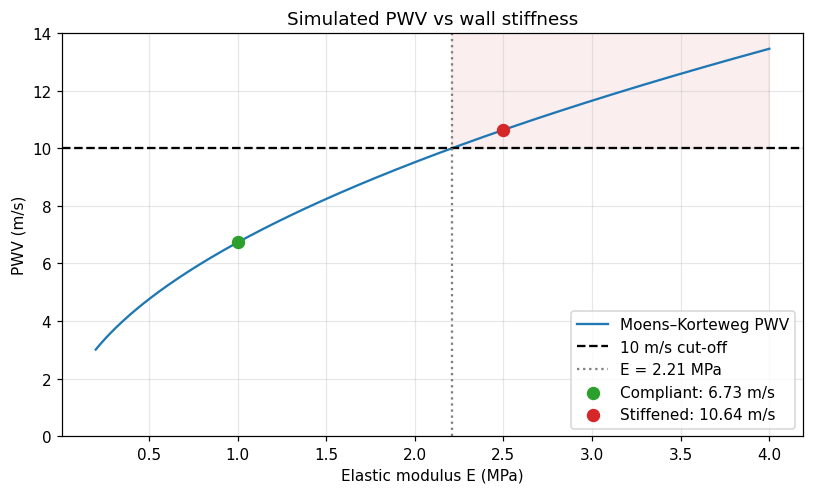
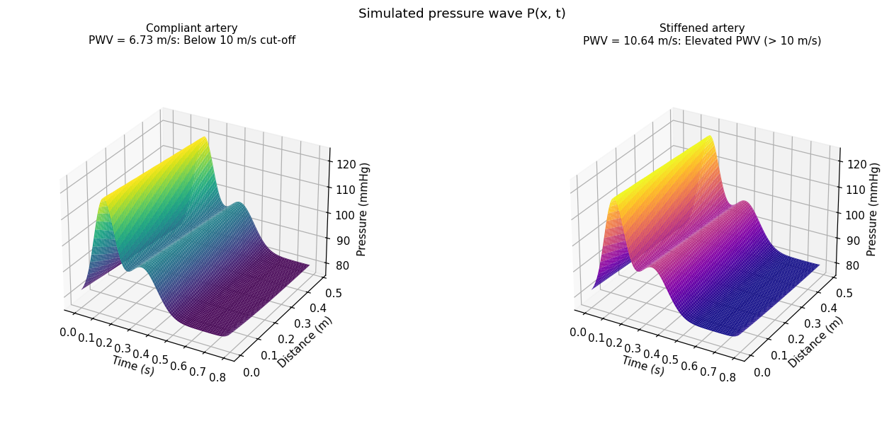
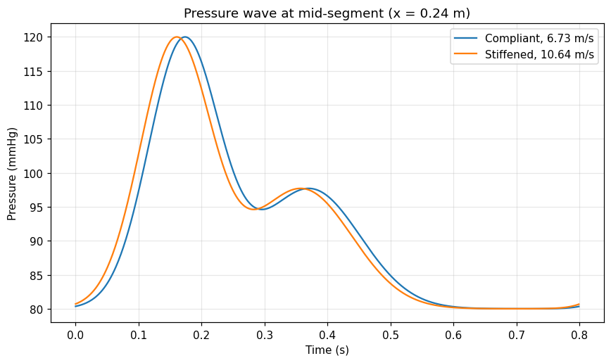
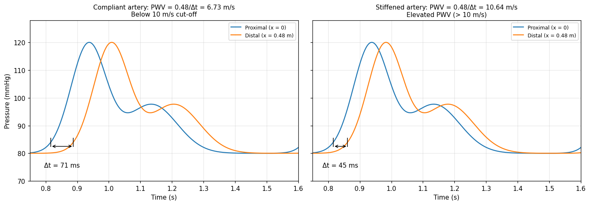

# Pulse Wave Velocity and Arterial Stiffness: Simulation


A Jupyter notebook that models how arterial wall stiffness affects pulse wave velocity (PWV). It uses the Moens–Korteweg equation, simulates pressure-wave propagation along an artery, recovers PWV from the simulated waveforms the way it is measured clinically, and compares the results with the 10 m/s carotid–femoral PWV cut-off.

> **Simulation only.** All inputs are assumed values. No patient data are used and no diagnostic performance (sensitivity, specificity) is evaluated. The output is not a validated clinical prediction or medical advice.

## Method

**PWV from wall properties.** The Moens–Korteweg equation gives the wave speed in a thin-walled elastic tube:

```
c0 = sqrt(E·h / (2·ρ·R))
```

| Symbol | Meaning | Unit |
|---|---|---|
| E | Incremental elastic modulus of the wall | Pa |
| h | Wall thickness | m |
| R | Inner radius | m |
| ρ | Blood density | kg/m³ |

The result is cross-checked against the Bramwell–Hill relation, which reduces to the same expression for a thin-walled cylinder.

**Pressure-wave simulation.** The pulse is a forward-travelling wave of fixed shape, `P(x, t) = P_ref(t − x/c0)`, with a periodic 120/80 mmHg waveform at 75 beats/min. The same waveform is used for both arteries, so the only difference between cases is wave speed.

**PWV from waveforms.** PWV is computed as travelled distance divided by transit time between a proximal and a distal site, using two methods:

- foot-to-foot (time at which the upstroke reaches 10% of pulse amplitude)
- cross-correlation with sub-sample refinement

**Classification.** A simulated PWV above 10 m/s is labelled *Elevated PWV*, otherwise *Below 10 m/s cut-off*. The cut-off comes from the 2012 expert consensus on carotid–femoral PWV, which uses 80% of the direct carotid–femoral distance. It is a screening threshold, not an age-adjusted reference value and not a diagnosis.

## Model parameters

| Parameter | Value |
|---|---|
| Blood density, ρ | 1060 kg/m³ |
| Inner radius, R | 12.5 mm |
| Wall thickness, h | 1.2 mm (h/R = 0.096) |
| Elastic modulus, compliant artery | 1.0 MPa |
| Elastic modulus, stiffened artery | 2.5 MPa |
| Heart rate | 75 beats/min |
| Blood pressure | 120/80 mmHg |
| Direct carotid–femoral distance | 0.60 m |
| Effective travelled distance | 0.48 m (80% of direct) |
| PWV cut-off | 10 m/s |

## Results

| Case | E (MPa) | PWV, Moens–Korteweg (m/s) | PWV, foot-to-foot (m/s) | PWV, cross-correlation (m/s) | Category |
|---|---|---|---|---|---|
| Compliant artery | 1.00 | 6.73 | 6.73 | 6.73 | Below 10 m/s cut-off |
| Stiffened artery | 2.50 | 10.64 | 10.64 | 10.64 | Elevated PWV (> 10 m/s) |

- With this geometry, PWV reaches 10 m/s at E ≈ 2.21 MPa.
- Increasing E by a factor of 2.5 increases PWV by a factor of 1.58 (the square root of the ratio).
- The distal pulse arrives about 26 ms earlier in the stiffened case.
- Transit-time estimates match the analytic values to within 1%. Because the simulated wave is non-dispersive, this verifies the numerical procedure, not the physiology.
- The classification is sensitive to the inputs: a ±20% change in E, h, R or ρ moves the stiffened case across the cut-off, and a ±5 ms timing error does the same.

## Screenshots

**Simulated PWV vs wall stiffness**



**Simulated pressure wave P(x, t)**



**Pressure wave at mid-segment**



**Transit-time estimation (proximal vs distal site)**



## Getting started

**Requirements:** Python 3.9 or later, `numpy`, `matplotlib`, and Jupyter.

```bash
pip install numpy matplotlib notebook
jupyter notebook PWV_Arterial_Stiffness_Detection.ipynb
```

Run all cells from top to bottom. The notebook also runs in Google Colab without changes. To execute it headlessly:

```bash
pip install nbconvert ipykernel
jupyter nbconvert --to notebook --execute PWV_Arterial_Stiffness_Detection.ipynb
```

Built-in assertions check the Bramwell–Hill agreement, √E scaling, the physiological pressure range, agreement between transit-time and analytic PWV, and consistency of the categories.

## Notebook structure

| Section | Description |
|---|---|
| 1. Theory | Moens–Korteweg equation, assumptions, clinical cut-off |
| 2. PWV and classification | Calculation, verification, categories |
| 3. Sensitivity | PWV vs elastic modulus, ±20% parameter changes |
| 4. Pressure-wave simulation | 3D P(x, t) surfaces, mid-segment waveform |
| 5. PWV from waveforms | Foot-to-foot and cross-correlation estimates, timing and distance error |
| 6. Summary | Results table generated from the calculations |
| 7. Limitations | Model limits and validation requirements |

## Limitations

- Thin-wall, linearly elastic model with constant E and uniform geometry; real arteries are non-linear, tapered and stiffen with pressure.
- No wave reflection, damping, dispersion or blood-pressure dependence.
- E, R, h and the pressure waveform are assumed, not measured.
- The 10 m/s cut-off applies to measured carotid–femoral PWV in people, not to model output.
- Clinical claims would require measured PWV with age, blood pressure and distance in a cohort, a reference standard or outcome data, and evaluation on held-out data.

g normal and reference values'. *Eur Heart J*. 2010;31(19):2338–2350.
3. Nichols WW, O'Rourke MF. *McDonald's Blood Flow in Arteries*. (Moens–Korteweg and Bramwell–Hill relations.)
